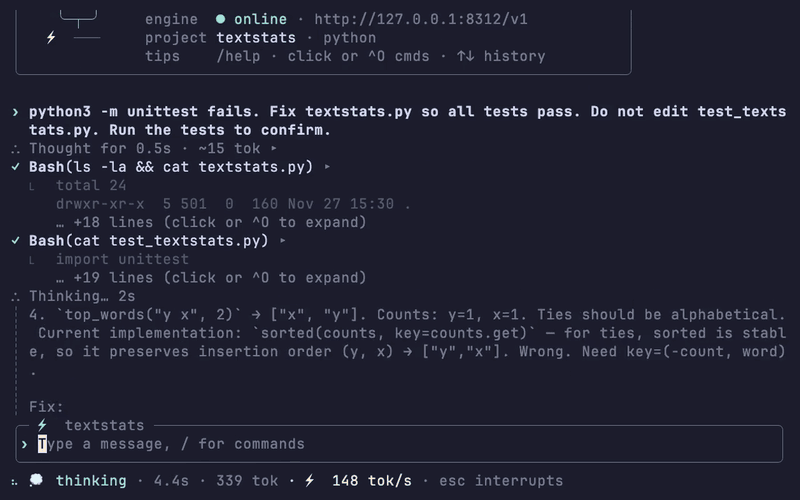

# flywheel

**A terminal coding agent in C for a model running on your Mac.**

The tested setup is Qwen3.8-27B served locally by Splash with a DFlash2 drafter. No cloud
account and no API key. flywheel is about 7k lines of C (plus vendored cJSON): the macOS build
links only `libcurl`, and the Linux build is static.



15 s excerpt of one real run at original speed (approvals answered by the recording script): [full 56 s video](https://megasoft1978.github.io/flywheel/) · [transcript](demo/transcript.jsonl).

[Website](https://megasoft1978.github.io/flywheel/) · [Results](#results) · [Safety](#safety) · [Limits](#limits) · MIT

## Results

Early, small and from one run each. Details and caveats are under [Benchmarks](#benchmarks).

- Private TypeScript/React suite: 8 of 13 tasks passed all hidden tests, score 10.15 of 13,
  median 5.7 minutes per task.
- Terminal-Bench 2.0 pilot: 4 of 10 hand-picked tasks.

## Tested stack

| part | what was used |
|---|---|
| model | [`uub336/Qwen3.8-27B-pi-mlx-4bit`](https://huggingface.co/uub336/Qwen3.8-27B-pi-mlx-4bit) (~15 GB, MLX) |
| drafter | [`z-lab/Qwen3.8-27B-DFlash2`](https://huggingface.co/z-lab/Qwen3.8-27B-DFlash2) (~3.9 GB) |
| engine | Splash 1.7.2 (`brew install incoai/tap/splash`) |
| machine | Apple M5 Max, 64 GB |

Smaller Macs are untested.

## Quickstart

macOS on Apple Silicon, with `clang` and `libcurl`. The model and drafter need about 19 GB of
disk. `setup` needs Homebrew and `aria2c` (`brew install aria2`) installed first.

```bash
git clone https://github.com/megasoft1978/flywheel
cd flywheel
make
./flywheel setup     # optional: installs the engine and downloads the model, asking first
./flywheel init      # writes .flywheel.md for the current project
./flywheel           # interactive session
```

Already running the server? Point at it:

```bash
FW_ENDPOINT=http://127.0.0.1:8312/v1 FW_MODEL=local/qwen-pi4 ./flywheel
```

flywheel speaks the chat-completions protocol to a local server. It sends no API key, so hosted
services that require one will not work. Other engines and models are untested.

Static Linux binaries (x86_64 and aarch64, needs `zig`): `bench-tb/build-zig.sh` → `dist/`.
The Linux build speaks plain HTTP only.

## Usage

```bash
flywheel                            # interactive REPL
flywheel "fix the bug in x.ts"      # one-shot (approves commands automatically, sandboxed)
flywheel -f prompt.md -T 60 -W 900 --transcript run.jsonl
flywheel bench <suite-dir> <tag>    # run a benchmark suite
```

| flag | meaning | default |
|---|---|---|
| `-e URL` / `-m NAME` | endpoint / model | `http://127.0.0.1:8312/v1` / `local/qwen-pi4` |
| `-C DIR` | working directory | current |
| `-P ts\|python\|go\|rust\|generic` | language profile | auto-detected |
| `-T N` / `-t SEC` | max turns / command timeout | 60 / 30 |
| `-W SEC` | wall clock, limits model requests only | off |
| `--gates N` | requirement-check passes before finishing | 1 |
| `--transcript FILE` | JSONL log of the run | off |
| `--allow-outside-writes` | throwaway containers only, see [Safety](#safety) | off |
| `--unsafe` | no sandbox, full environment; see [Safety](#safety). Goes before `bench` | off |

`flywheel --help` lists the rest. Settings can also live in `~/.config/flywheel/config`.
Project instructions come from the first of `.flywheel.md`, `AGENTS.md` or `CLAUDE.md`
(first 3,800 characters). A file that links outside the project or into a credential store is skipped.

## What the harness does

- **Loop breaker.** When similar commands keep returning similar results, it prunes those turns,
  adds a correction and temporarily raises temperature. The second and fourth prunes also restart the
  context from the task, the file list and the check output. Successful file edits count as repeats only
  when their text is identical.
- **Tool-call repair.** Recovers shell commands from JSON containing raw control characters.
  Truncated or auto-closed arguments are rejected, never executed.
- **File tools.** `write_file` and `edit_file` with unique-match edits and atomic replacement, confined to the project.
  A file with several hard links is not written. A file whose owner or group cannot be kept, or in a
  directory that refuses new files, is written in place instead, which is not atomic.
- **Verification gate.** A per-language check (`tsc --noEmit`, `python3 -I -m compileall`,
  `go vet`, `cargo check`) and one requirement-by-requirement pass before finishing. A passing
  check means the code type-checks or compiles, not that it is correct. A run whose last check
  fails or times out ends as `check-failed` or `check-timeout`, not `done`. Go and Rust are
  experimental.
- **Transient errors.** HTTP 429 and 5xx and dropped connections are retried up to three times;
  cut-off streams are reported as errors.

## Interactive terminal UI

- Keep typing while the agent works: Enter queues, `Esc` interrupts, scrollback stays put.
- Streaming markdown, code boxes, tables and links.
- Tool output and thinking collapse; click or `^O` to expand.
- Slash menu (`/init /clear /model /allow /status /help /exit`), input history,
  large-paste collapse.
- Live tokens per second (end to end), context gauge and completion summary.

## Safety

flywheel runs shell commands and project code on your machine. On macOS, the commands the model
runs and the verification gate go through a Seatbelt sandbox (`sandbox-exec`): **they cannot write
outside the project or reach the network unless you approve it.** That is the whole claim. Run an
untrusted repository or task in a VM.

**Sandbox (macOS)**

- Writes: the working directory and a private `$TMPDIR` (plus `/dev/null` and similar). Not `/tmp`.
  Not the project's `.envrc`, `.git/hooks`, `.git/config`, `.git/config.worktree` or
  `.git/commondir`, which run or redirect code later, outside the sandbox. Without a real `.git`
  directory, nothing can create `.git`, nor a `HEAD` in the root. The project directory itself and
  the directories above these files and the stores below cannot be renamed or removed.
- Nested repositories, `.git/modules`, `.git/worktrees` and nested `.envrc`: those that exist when
  a command starts have config, hooks, `commondir`, `.git` link files and `.envrc` closed. New ones
  are checked when the command ends; a config with anything beyond what `git init`, `clone`,
  `worktree` and `submodule` write, a hook, an `.envrc` or a redirecting link is renamed to
  `*.fw-quarantined-N`. Nothing that existed before the command or file tool call is renamed: if
  old files would now make a repository, only its new `HEAD`, `commondir`, `objects` or `refs` is;
  an old file moved to such a place is reported. A marker directory that is not empty is left
  and reported, even if that leaves a repository there.
- Every process a command leaves behind, detached ones included, is killed before that check, so
  background servers do not survive their command.
- With more than about 600 such nested files (many repositories, packages that ship `.envrc`),
  they are closed by name instead of one by one: nothing can then create a nested `.git` or
  `.envrc`, so `git init`, `clone` and `worktree add` inside the project, and installing such
  packages, fail.
- In a tree that cannot be checked completely (over 200,000 entries, an unreadable directory, a
  project root that is not writable, or a volume other than APFS) nothing is renamed, and more is closed up front: creating `HEAD` outside `.git`, `config`,
  `config.worktree` or `commondir` files below the root, and git hook names in any `hooks`
  directory. The command gets an empty `$TMPDIR` of its own. The output says so.
- In a linked git worktree, also its own git directory and the main repository's `objects`, `refs`
  and `logs`, so commits work. Config and hooks there stay closed.
- Reads: everything you can read, except these credential stores in your home directory, which are
  neither readable nor writable, also through the file tools and where they are symlinks:
  `~/.ssh`, `~/.aws`, `~/.gnupg`, `~/.kube`, `~/.docker`, `~/.azure`, `~/.netrc`,
  `~/.git-credentials`, `~/.config/{gh,flywheel,gcloud}`, `~/.npmrc`, `~/.pypirc`,
  `~/.cargo/credentials*`, `~/.gem/credentials`, `~/.pgpass`, `~/.vault-token`,
  `~/.m2/settings.xml`, `~/.gradle/gradle.properties`, shell and REPL history files, keychains,
  cookies and the common browser profiles. **Any file not on that list stays readable**, including
  other tokens and `.env` files, and its contents can reach the model.
- Network: none, not even localhost. In an interactive session the model can ask for it for one
  command; you are asked every time, whatever your "always allow" rules say. One-shot and `bench`
  cannot grant it. Allowed network is any IP address, not one host.
- Environment: only `PATH`, `HOME`, `LANG` and `TERM` are passed on; `TMPDIR`, `XDG_CACHE_HOME`,
  `GOCACHE` and `npm_config_cache` point into the private temporary directory.

What stops working inside it:

- Tools that write under `$HOME`: package caches and global installs (`cargo`, `pip --user`,
  Gradle and the like). Fetch dependencies yourself first.
- `git init` in the project root, and anything that writes `.git/config` or hooks: `git config`,
  `git remote add`, `git push -u`, `git branch -u`, `git submodule add`, hook installers such as
  husky or `pre-commit install`. `add`, `commit`, branches and stash work. Git may report success
  although the setting was not saved; the tool output says so.
- Changing the config or hooks of, or renaming or removing, a nested repository or worktree that
  already existed.
- Tools that need a denied file: private registry logins in `~/.npmrc`, `~/.m2/settings.xml`,
  `~/.gradle/gradle.properties` and the like.
- `git fetch`/`push` (offline; over SSH it also fails with network approved, as keys and
  `known_hosts` are unreadable), and Keychain or `gh` credentials.
- A submodule opened as the project, or a worktree whose link back from the main repository does
  not match: no commits.
- New file names with non-ASCII characters in a directory that holds a credential store.
- Docker, `ssh-agent` and other Unix sockets, local servers and tests that open a port (unless
  network is approved), `ps`, pseudo-terminals, `open` and AppleScript.

Where it does not protect you:

- Other files inside the project can be changed, including build scripts, `Makefile`,
  `package.json` and hook directories named by `core.hooksPath` (such as `.husky`). You or your
  editor may later run them **outside** the sandbox.
- The check on new nested git files runs when a command ends. If flywheel is killed during a
  command, there is no check and the command's processes keep running. A directory the command
  made unreadable is reported, not checked. A file that existed before and was moved to a nested
  `.envrc` is only reported. Whatever else creates such files in the project during a command
  is treated the same way as the command.
- Started in your home directory (or above it), the sandbox makes all of it writable, except the
  stores listed above.
- A store reached through a chain of several symlinks is protected at both ends, but a link in the
  middle of the chain can be renamed.
- File tools do not go through the sandbox; they have their own project confinement and refuse the
  stores and the protected files.
- **`bench` grading scripts run the code the model wrote, unsandboxed and with your environment.**
  Run untrusted suites or models in a VM.
- With `--unsafe` or without a sandbox, a process that detaches itself from a command keeps
  running after it ends.

**No sandbox** (Linux, or `sandbox-exec` unavailable, for example inside another sandbox):
one-shot and `bench` refuse to run unless you pass `--unsafe`. Interactive mode says so and keeps
asking for approval. `--unsafe` turns the sandbox and the environment filtering off.

**Interactive mode**

- Asks before running anything that is not on a short read-only list. Chaining, redirection,
  shell expansion and write or exec flags prompt. So does `git`, because a repository's config
  and hooks can make even `git status` run a program.
- Asks before running the verification gate, showing the exact command. If you decline, the
  summary says the check was not run.
- The dialog shows the whole command, with control and invisible characters made visible, and
  ignores keys typed before it appeared.
- "Always allow" rules are stored per project under `~/.config/flywheel/`; rules shipped inside
  a repository are not trusted. A remembered `npm run`, `go test`, `cargo test` or gate check runs
  whatever the project files contain at that moment, including files the model wrote.

**One-shot and `bench` modes approve everything automatically**, the verification gate included
(network excepted).
`tsc` (through `npx`, which uses a project-local binary), `cargo check` (which runs `build.rs`)
and similar tools execute code from the project.

**Deny rules are best-effort** (`sudo`, destructive `rm`, writes outside the project) and apply
in every mode. They read the command text only:

- Scripts, interpreters, build tools and unlisted commands (`shred`, `tar`, `curl -o`)
  are not inspected.
- Values of unknown `$VARS`, the output of `$(...)` and arguments fed through `xargs` are not seen.
- Write checks do not follow symlinks.
- They allow `/tmp` and `/dev` (except disk devices); the sandbox does not.
- Keeping reads inside the project applies only to the auto-approved built-in commands.

`--allow-outside-writes` is for throwaway containers: commands may write and delete outside the
working directory, recursively too. `sudo`, the other basic deny rules and recursive `rm` of `/`
or your home directory stay blocked. It relaxes only these text rules: on macOS the sandbox still
applies unless `--unsafe` is also given.

## Limits

- Text only. The model has vision, but flywheel sends it text only.
- No API key support. The Linux build has no HTTPS.
- No context compaction.
- No sandbox on Linux yet.
- Detached background processes are found and killed only for sandboxed commands.
- Go and Rust gates are experimental.
- The harness was tuned on the private suite below.
- Not yet measured against OpenCode with the same model, or against Claude Haiku 5.5 run as an
  agent. The planned protocol is in [`bench/PROTOCOL.md`](bench/PROTOCOL.md).

## Benchmarks

### Terminal-Bench 2.0 pilot: 4 of 10 tasks

flywheel with Qwen3.8-27B running locally, through a [Harbor](https://github.com/harbor-framework/harbor) custom agent.

| passed | failed |
|---|---|
| `count-dataset-tokens` | `chess-best-move` (needs reading an image) |
| `extract-elf` | `circuit-fibsqrt` |
| `fix-git` | `make-mips-interpreter` |
| `git-multibranch` | `dna-insert` |
| | `filter-js-from-html` |
| | `gcode-to-text` |

**This is not a leaderboard score and should not be compared with one.** The 10 tasks were
hand-picked, not the full set; each ran once; seven were re-run after a Docker network outage
stopped them from starting; and the two sessions used different builds. It also predates a
fix for missing file-tool parameter schemas. A full run is still to be done.

### Coding suite: 13 TypeScript and React tasks

A private suite of hidden-test tasks. Score = fraction of tests passing per task, zero if the
type check fails, summed over 13.

| runner | protocol | first attempt | after retry | tasks fully passing |
|---|---|---|---|---|
| flywheel + Qwen3.8-27B (local) | agent loop, one run | 10.15 | — | 8 / 13 |
| Claude Sonnet 5.5 | one-shot generation, no tools | 12.00 | 13.00 | 12 / 13, then 13 / 13 |
| Claude Haiku 5.5 | one-shot generation, no tools | 12.00 | 13.00 | 12 / 13, then 13 / 13 |

**The Claude models are clearly ahead.** The protocols differ, so this is a reference point
rather than a head-to-head: the Claude runs wrote code without tools and the retry was shown
the failing hidden test; flywheel ran as an agent and never saw those tests. The Haiku row
combines two runs (8 tasks and 5). flywheel was also tuned on this suite, the suite is not
public, and the flywheel run predates the current build. An earlier Python version of the
harness scored higher on total score (11.74) with fewer tasks fully passing (7 / 13).

### Reproducing the pilot

Needs Docker, Harbor (`uv tool install harbor`), `zig`, and a local engine on `:8312`:

```bash
bench-tb/build-zig.sh
bench-tb/run-slice.sh
bench-tb/harvest.sh
```

## Development

```bash
make              # build
make test-unit    # unit tests, both HTTP transports
make test         # unit tests + terminal UI tests
make sanitize     # the same under AddressSanitizer and UBSan
```

The terminal UI tests drive the real binary through
[mica-terminal](https://github.com/megasoft1978/mica-terminal), expected at `../mica-terminal`
with `build/libvterm.a` built. Without it, `make test` skips them and says so.

## License

[MIT](LICENSE)
