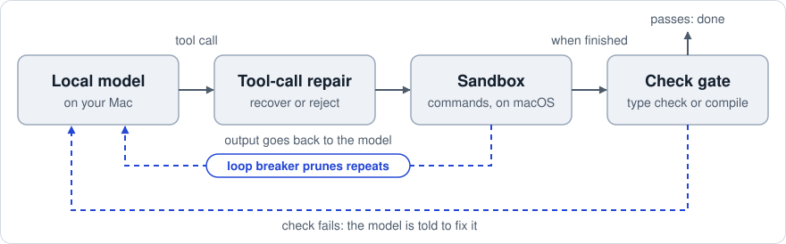

# flywheel

**A terminal coding agent in C for a model running on your Mac: no cloud account, no API key.**


15 s excerpt of one real run at original speed (approvals answered by the recording script), from an
earlier build: [full 56 s video](https://megasoft1978.github.io/flywheel/) · [transcript](demo/transcript.jsonl).

[Website](https://megasoft1978.github.io/flywheel/) · [Safety](#safety) · [Limits](#limits) · [Results](#results) · MIT

## How it works



File edits do not run in the sandbox; the file tools are confined to the project. The check gate is a
type check or compile, also run now and then on long runs: passing it does not mean the code is correct.

## Why use it

- **Local, no API key.** The model runs on your Mac. flywheel is about 11k lines of C (plus vendored
  cJSON), and the macOS build links only `libcurl`.
- **Sandboxed on macOS.** Commands the model runs cannot write outside the project and a private temp
  directory, or reach the network unless you approve it. [Limits apply](#safety).
- **Built for a local model's mistakes.** A loop breaker prunes repeated turns. Tool-call repair
  recovers shell commands from JSON with raw control characters and never runs truncated ones.

## Quickstart

macOS on Apple Silicon, with `clang` and `libcurl`. `setup` needs Homebrew and `aria2c`
(`brew install aria2`); the model and drafter need about 19 GB of disk.

```bash
git clone https://github.com/megasoft1978/flywheel
cd flywheel
make
./flywheel setup     # installs the engine and downloads the model, asking first
./flywheel           # interactive session
```

Tested with Qwen3.8-27B served by Splash with a DFlash2 drafter on an M5 Max, 64 GB
([details](docs/advanced.md#tested-stack-and-servers)). Smaller Macs, other engines and other models
are untested.

## Usage

`make install` copies the binary to `~/.local/bin`.

```bash
flywheel                      # interactive session
flywheel "fix the bug"        # one-shot: approves commands automatically
flywheel -f task.md           # task from a file
flywheel setup                # engine + model
```

Options: `-C DIR` working directory, `-m MODEL`, `-e URL` endpoint, `--unsafe`, `--version`,
`--help` (`--help all` lists more). Images: drag a file in, type its path or URL, or `/paste`
([details](docs/advanced.md#images)).

## Safety

> [!WARNING]
> flywheel runs shell commands and project code on your machine.
>
> - **No sandbox on Linux.** There, approved commands can write anywhere you can and use the network.
> - **A project `.env` is readable by the model**, as are other secrets in the places it may read.
> - **One-shot approves commands automatically** (so does `bench`; network excepted).
> - **Use a VM for untrusted repositories** and untrusted tasks.

On macOS, the commands the model runs and the verification gate go through a Seatbelt sandbox. Files
inside the project can still change, including build scripts you may later run outside it.
Everything you can read outside your home directory stays readable and can reach the model.
Start flywheel in a project directory, not in your home directory.
[Full safety page](docs/safety.md): every rule, exception and known gap.

## Limits

- No API key support, so hosted services that require one will not work.
- The Linux build has no HTTPS and no sandbox.
- No context compaction.
- Images only from typed or pasted input; no audio or video.
- Go and Rust checks are experimental.
- Detached background processes are found and killed only for sandboxed commands that had the
  network, and for `bench` grading scripts.

## Results

No scored benchmark or same-model comparison yet; Terminal-Bench 2.1 is being prepared ([protocol](bench/PROTOCOL.md)).
Early single runs and their caveats are in [benchmarks](docs/benchmarks.md): on a private suite that
flywheel was tuned on, Claude models scored clearly higher, under a different protocol.

## Docs

- [Safety](docs/safety.md): the sandbox in full.
- [Advanced](docs/advanced.md): flags, config, images, harness behaviour, terminal UI, development.
- [Benchmarks](docs/benchmarks.md): early runs and how to reproduce the pilot.

## License

[MIT](LICENSE)
